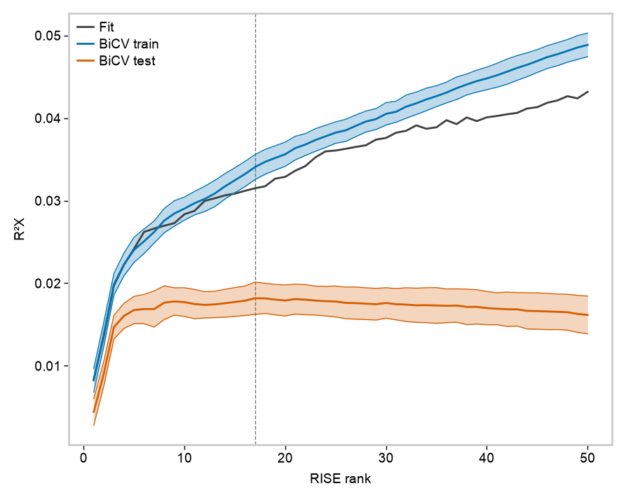
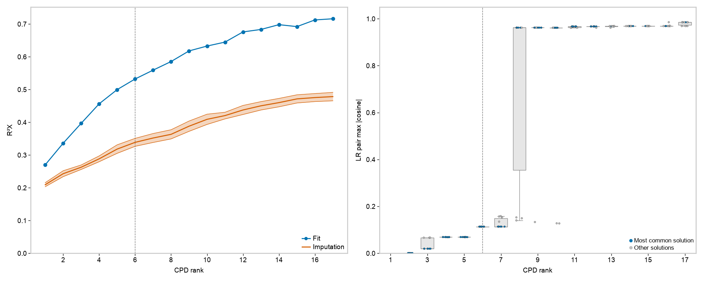
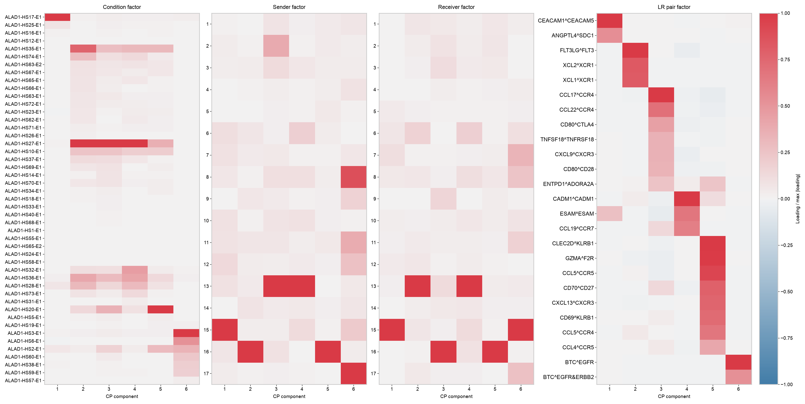
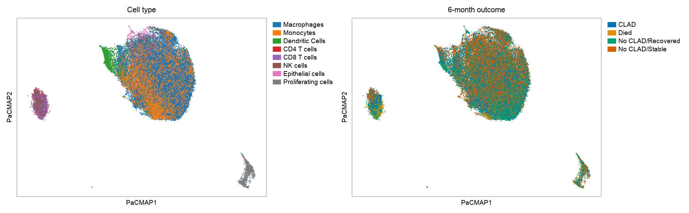
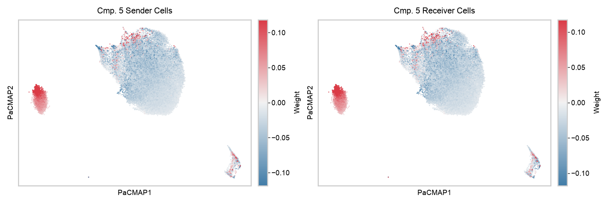
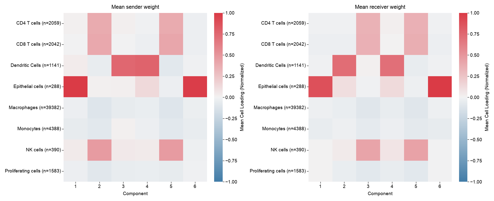
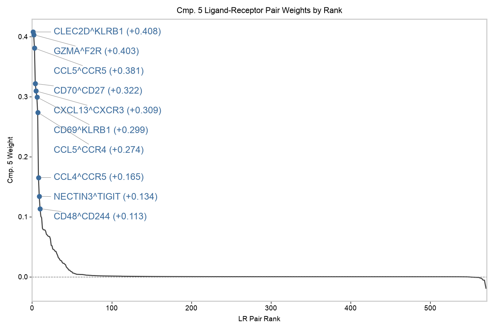
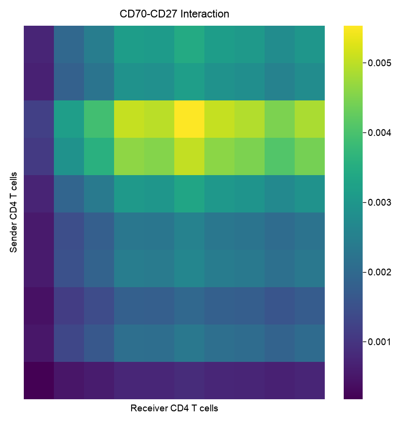

Tutorial for cccRISE: Cell-Cell Communication Analysis
========================================================

This tutorial demonstrates the complete cccRISE workflow for analyzing cell-cell communication in single-cell RNA-seq data across experimental conditions. It follows the analysis of the acute lung allograft dysfunction (ALAD) cohort: bronchoalveolar lavage (BAL) samples from 47 lung transplant recipients (about 51,000 cells), annotated with each sample's ALAD status and 6-month and 1-year outcomes. Every figure below is generated from the canonical ALAD fit by ``docs/generate_tutorial_figures.py``.

Installation
------------

To add cccRISE to your Python package, add the following line to your ``requirements.txt`` and remake your virtual environment::

    git+https://github.com/meyer-lab/cccRISE.git@main

Preprocessing the Dataset
--------------------------

Input Requirements
^^^^^^^^^^^^^^^^^^

Your AnnData object must meet the following requirements:

1. **Condition Index**: Include an observations column ``condition_unique_idxs`` that is a 0-indexed array indicating which condition each cell is derived from, along with the cell barcode. Condition 1 cells are indexed as 0, Condition 2 as 1, and so on.

2. **Preprocessing**: Your AnnData object must be preprocessed (doublets removed, genes filtered, normalized, and log-transformed) before running cccRISE. Standard preprocessing functions can assist with gene filtering, normalization, and assigning ``condition_unique_idxs``.

Ligand-Receptor Pairs
^^^^^^^^^^^^^^^^^^^^^

cccRISE requires a DataFrame of ligand-receptor pairs to analyze cell-cell communication. This can be obtained from resources like CellChat or other ligand-receptor databases.

**Required DataFrame Format**:

- Must contain columns named ``ligand`` and ``receptor``
- Gene names should match those in your AnnData object (typically uppercase)
- For protein complexes, subunits should be separated by ``&`` (e.g., ``ITGA4&ITGB7``)
- Example structure::

    ligand        receptor
    GZMA          F2R
    CD70          CD27
    ITGA4&ITGB7   VCAM1

The package includes a default function ``import_ligand_receptor_pairs()`` that loads a curated database from CellChat, but you can provide your own DataFrame following this format.

Import and Prepare the Dataset
^^^^^^^^^^^^^^^^^^^^^^^^^^^^^^^

The ``prepare_dataset`` function assists with preprocessing your data. Parameters:

- ``X``: AnnData object containing raw count data in sparse matrix format
- ``condition_name``: Name of the column in ``X.obs`` that specifies experimental conditions for each cell
- ``geneThreshold``: Minimum mean expression threshold for gene filtering (genes with mean expression below this value are removed)
- ``normalize``: If True, normalizes and log-transforms the counts (default: False)

The function performs the following steps:

- Filters cells with 10 or fewer total counts
- Filters genes based on the ``geneThreshold`` parameter
- With ``normalize``, normalizes total counts per cell to the median, scales each gene by its total, and applies log₁₀((1000 × normalized_value) + 1)
- Creates ``condition_unique_idxs`` column in ``X.obs`` with 0-indexed condition assignments
- Pre-calculates gene means and stores in ``X.var["means"]``

**Example Code**:

For your own data, prepare an AnnData object of raw counts::

    from cccrise.import_data import prepare_dataset, import_ligand_receptor_pairs
    import anndata

    X = anndata.read_h5ad("your_data.h5ad")
    X = prepare_dataset(X, condition_name="sample", geneThreshold=0.001, normalize=True)
    lr_pairs = import_ligand_receptor_pairs()

The ALAD cohort is registered in ``cccrise.runners.datasets.DATASETS``. Its loader (``import_alad``) filters and normalizes the data, annotates cell types (``broad_cell_type``), and indexes the samples (``dsco_id``); the source file lives on the lab server (``/opt/IVCSC/BAL-scRNAseq.raw.h5ad``)::

    from cccrise.runners.datasets import DATASETS

    spec = DATASETS["alad"]
    X = spec.load()
    lr_pairs = import_ligand_receptor_pairs()

Choosing the Rank
------------------

cccRISE involves two sequential factorization steps, each requiring rank selection:

1. **RISE Rank Selection**: Determines how many eigenstates to extract from the scRNA-seq data
2. **CPD Rank Selection**: Determines how many components to use when factorizing the interaction tensor

In-sample R²X (the fraction of variance explained) rises with every added component, so both ranks are judged by how well a fit predicts data it did not see. Each step has a runner that sweeps the ranks and saves the results, with a provenance file, under ``cccrise/data/rank_selection_results/``.

RISE Rank Selection
^^^^^^^^^^^^^^^^^^^

**What is RISE?**

RISE (Reduction and Insight in Single-cell Exploration) is an unsupervised, tensor-based computational method designed for the integrative analysis of single-cell RNA sequencing (scRNA-seq) data across multiple experimental conditions, such as drug treatments, patient cohorts, or time points. Built upon the PARAFAC2 tensor decomposition framework, RISE preserves the inherent three-dimensional structure of multi-condition single-cell data—conditions × cells × genes—instead of flattening it into a conventional two-dimensional matrix. The RISE rank determines how many latent patterns (eigenstates) are extracted before computing cell-cell communication scores.

**Evaluate RISE Ranks**

RISE ranks are compared by bi-cross-validation (BiCV): each repeat holds out half of the cells and half of the genes, fits RISE on the rest, and scores the prediction of the held-out block. Run the sweep from the command line::

    uv run cccrise-riserank --dataset alad

or from Python::

    from cccrise.runners.run_rise_rank import run_rise_rank_selection

    sweep, _, _ = run_rise_rank_selection(spec, ranks=list(range(1, 51)))

Then plot the full-data fit and BiCV R²X against rank::

    import matplotlib.pyplot as plt
    from cccrise.figures import common
    from cccrise.runners.datasets import RANK_SELECTION_DIR

    sweep = common.load_runner_output(spec.rise_rank_filename(), RANK_SELECTION_DIR)
    fig, ax = plt.subplots(figsize=(5, 4))
    common.plot_rise_rank(sweep, ax, rank=17)
    plt.show()

**Interpretation**:

- **Fit and BiCV train R²X**: rise with every added eigenstate, so they cannot choose a rank on their own.
- **BiCV test R²X**: the prediction of unseen cells and genes. It peaks or plateaus near the rank that generalizes, and falls once added eigenstates fit noise.
- **ALAD**: the canonical fit uses RISE rank 17 (dashed line), near the peak of the held-out R²X.

CPD Rank Selection
^^^^^^^^^^^^^^^^^^

**What is CPD?**

After RISE, an interaction tensor is computed from cell-cell communication scores between all eigenstate pairs across L-R pairs and conditions. CPD (Canonical Polyadic Decomposition) factorizes this tensor to identify interpretable communication patterns. The CPD rank determines how many communication components are extracted.

**Evaluate CPD Ranks**

The CPD runner rebuilds the interaction tensor of the dataset's canonical RISE fit (see `Running the Factorization`_), fits CP at each rank from 10 seeded SVD starts, and estimates each rank's imputation R²X by k-fold masking of the tensor::

    uv run cccrise-cpdrank --dataset alad

Plot the fit and imputation R²X, and, for each start, the largest cosine similarity between any two components' LR pair factors::

    fig, ax = plt.subplots(1, 2, figsize=(10, 4))
    cp_sweep = common.production_fits(common.load_cpd_rank("alad"))
    common.plot_cpd_fit_r2x(cp_sweep, ax[0], rank=6)
    common.plot_cpd_imputation_r2x(common.load_cpd_imputation("alad"), ax[0])
    common.plot_collinearity_boxes(ax[1], "alad", rank=6)
    plt.tight_layout()
    plt.show()

**Interpretation**:

- **Fit R²X**: rises with every added component.
- **Imputation R²X**: the prediction of masked tensor entries. Ranks that keep improving it capture structure rather than noise.
- **LR pair collinearity**: once two components' LR pair factors become near-duplicates (max cosine near 1), added components split existing programs rather than finding new ones, and the starts disagree on which solution they reach.
- **ALAD**: the canonical fit uses CPD rank 6 (dashed line), the largest rank at which every start reaches the same solution (10 of 10 starts; rank 7: 6 of 10) before the LR pair factors become collinear at rank 8.

Running the Factorization
--------------------------

**Perform cccRISE Factorization**

Based on the rank selection analysis above, choose RISE and CPD ranks and run the complete cccRISE workflow. This performs the two-step factorization: first extracting eigenstates from the expression data (RISE), then factorizing the resulting interaction tensor (CPD)::

    from cccrise import run_ccc_rise_workflow

    fit = run_ccc_rise_workflow(
        adata=X,
        rise_rank=17,
        cp_rank=6,
        lr_pairs=lr_pairs,
        rise_n_iter_max=300,
        cp_n_iter_max=4000,
        rise_tol=1e-8,
        cp_tol=1e-12,
        condition_column="dsco_id",
        random_state=42,
        complex_sep="&",
        doEmbedding=True
    )
    X, r2x = fit["adata"], fit["r2x_cp"]

    print(f"Variance Explained (R²X): {r2x:.4f}")

For a registered dataset, the ``cccrise-run`` runner fits the same model and saves it in the format of the dataset's canonical factors file (``cccrise/data/factors/bal_alad_factors.nc``), with a provenance file recording the ranks and fit options. The committed ALAD file was refit at CPD rank 6 after the ligand-receptor database was cleaned: its CP step was rerun on the stored RISE fit, which does not read the ligand-receptor list, and the provenance file's ``generated_by`` field records that procedure. Rerunning the command below refits RISE as well, so it need not reproduce the committed file exactly::

    uv run cccrise-run --dataset alad --rise-rank 17 --cp-rank 6

**Function Parameters**

The ``run_ccc_rise_workflow`` function executes the complete cccRISE pipeline:

- ``adata``: AnnData object with preprocessed scRNA-seq data
- ``rise_rank``: Number of PARAFAC2 components to extract from expression data
- ``cp_rank``: Number of CPD components for factorizing the interaction tensor (if None, defaults to ``rise_rank``)
- ``lr_pairs``: DataFrame of ligand-receptor pairs with 'ligand' and 'receptor' columns
- ``condition_column``: Column name in ``adata.obs`` containing condition identifiers (default: "sample")
- ``rise_n_iter_max``, ``cp_n_iter_max``: Maximum iterations for the RISE and CP fits (required; the runners use 300 and 4000)
- ``rise_tol``, ``cp_tol``: Convergence tolerances for the RISE and CP fits (required; the runners use 1e-8 and 1e-12, defined in ``cccrise.runners._cli``)
- ``random_state``: Random seed for reproducibility (default: None)
- ``complex_sep``: Separator for protein complexes in L-R pairs (default: "&")
- ``communication_score``, ``hill_k``: Communication scoring function and its Hill constant (default: "expression_product", 0.5)
- ``doEmbedding``: If True, computes PaCMAP embeddings for visualization (default: False)
- ``backend``: RISE backend ('cpu', 'cupy', 'mlx', or None to auto-detect; default: None)
- ``compress``: Fit RISE in a compressed gene/cell subspace (default: False); CPD is never compressed
- ``cp_device``, ``cp_dtype``: Device and precision of the CPD fit (default: the GPU when there is one, in float32)
- ``keep_tensor``: Return the interaction tensor (default: False)

**What Gets Stored**

The function returns a dict with keys ``adata``, ``tensor`` (``None`` unless ``keep_tensor``), ``filtered_lr_pairs``, ``cp_weights``, ``cp_factors``, ``r2x_rise``, ``r2x_cp`` and ``diagnostics`` (CPD component collinearity). The following are stored in the AnnData object:

**Factor Matrices** (in ``X.uns``):

- ``X.uns["weights"]`` - Component weights (array of length ``cp_rank``)
- ``X.uns["A"]`` - Condition factor matrix (n_conditions × ``cp_rank``)
- ``X.uns["B"]`` - Sender cell type factor matrix (``rise_rank`` × ``cp_rank``)
- ``X.uns["C"]`` - Receiver cell type factor matrix (``rise_rank`` × ``cp_rank``)
- ``X.uns["D"]`` - Ligand-receptor pair factor matrix (n_lr_pairs × ``cp_rank``)

**Cell Projections** (in ``X.obsm``):

- ``X.obsm["projections"]`` - Cell projections from PARAFAC2 (n_cells × ``rise_rank``)
- ``X.obsm["sc_B"]`` - Sender cell loadings (n_cells × ``cp_rank``)
- ``X.obsm["rc_C"]`` - Receiver cell loadings (n_cells × ``cp_rank``)
- ``X.obsm["PaCMAP"]`` - PaCMAP embedding for visualization (n_cells × 2, if ``doEmbedding=True``)

Saving and Loading Factor Models with NetCDF
--------------------------------------------

Rather than saving entire multi-gigabyte AnnData files containing full single-cell matrices, you can export the decomposition factor matrices and metadata to a compact NetCDF file (a few MB)::

    from cccrise.factors import factors_to_xarray, save_factors_netcdf, load_factors_to_anndata

    # 1. Export factors to an annotated xarray Dataset
    factors_ds = factors_to_xarray(
        cpd_factors=[X.uns["A"], X.uns["B"], X.uns["C"], X.uns["D"]],
        cpd_weights=X.uns["weights"],
        filtered_lr_pairs=X.uns["lr_pairs"],
        condition_names=X.obs["dsco_id"].unique(),
        gene_names=list(X.var_names),
        r2x_cp=r2x,
    )

    # 2. Save lightweight NetCDF file
    save_factors_netcdf(factors_ds, "study_factors.nc")

    # 3. Load on-demand and project single cells instantaneously
    X_projected = load_factors_to_anndata("study_factors.nc", adata=X_raw, do_embedding=True)

**Additional Information**:

- ``X.uns["lr_pairs"]`` - Array of ligand-receptor pair names used in the analysis
- ``X.uns["r2x"]`` - Variance explained by the CPD factorization

Loading the ALAD Fit
^^^^^^^^^^^^^^^^^^^^

The figures below project the cells onto the canonical ALAD fit rather than refitting it::

    from cccrise.factors import load_factors_to_anndata

    X = load_factors_to_anndata(spec.factors_path(), adata=spec.load())

Visualizing the Factors
------------------------

cccRISE decomposes cell-cell communication into four factor matrices, each revealing different aspects of the communication patterns. The plotting functions below are those of the cccRISE explorer app (``cccrise.app.plots``).

**Overview of the Four Factors**

The factorization produces four interpretable factor matrices:

1. **Factor A (Condition Factor)**: Shows how each experimental condition (e.g., patient sample, time point) contributes to each component
2. **Factor B (Sender Cell Eigenstate)**: Represents sender cell patterns in the latent RISE space
3. **Factor C (Receiver Cell Eigenstate)**: Represents receiver cell patterns in the latent RISE space
4. **Factor D (Ligand-Receptor Pairs)**: Shows which L-R pairs drive each communication component

**Visualize All Four Factors**

Plot each factor matrix, each component divided by its largest magnitude, keeping only the LR pairs whose largest loading exceeds ``lr_weight``::

    from cccrise.app.plots import plot_cp_factor_heatmaps

    fig, axes = plt.subplots(1, 4, figsize=(16, 8), constrained_layout=True)
    plot_cp_factor_heatmaps(X, axes, condition_col="dsco_id", lr_weight=0.15)
    plt.show()

**Understanding Each Factor**

- **Factor A (Condition)**: Rows are samples, grouped by the component they load most heavily on. High values indicate which samples are enriched in each communication pattern.

- **Factor B (Sender Eigenstate)**: Each row is a RISE eigenstate, each column a CPD component, showing which latent sender cell states participate in each component.

- **Factor C (Receiver Eigenstate)**: Similar to Factor B but for receiver cells.

- **Factor D (LR Pairs)**: Shows which ligand-receptor interactions drive each component. Only top-weighted pairs are displayed for clarity.

**Visualize Cell Projections with PaCMAP**

Explore how individual cells are positioned in the RISE eigenstate space, colored by cell type and by their sample's 6-month outcome::

    import numpy as np
    from cccrise.app.plots import pacmap_axes, plot_categorical_scatter, plot_celltype_points
    from cccrise.figures import style

    fig, axes = plt.subplots(1, 2, figsize=(10, 4.5), constrained_layout=True)
    points = np.asarray(X.obsm["PaCMAP"])
    plot_celltype_points(axes[0], X, "alad", points)
    outcome = X.obs["6monthcondition"].astype(str).to_numpy()
    colors = dict(zip(sorted(set(outcome)), style.CATEGORICAL))
    plot_categorical_scatter(axes[1], points, outcome, colors)
    for ax in axes:
        pacmap_axes(ax)
    plt.show()

Interpreting a Component
-------------------------

Once you've identified components of interest, dig deeper into the specific cell types and ligand-receptor pairs driving the communication patterns. In ALAD, component 5 is the component whose condition loadings are associated with 6-month outcome (tested by ANOVA; see ``cccrise.anova.run_saved_factors_anova``).

**Visualize Specific Component Loadings**

Color each cell by its sender and receiver weight on the component::

    from cccrise.app.plots import plot_value_pacmap

    component = 5
    fig, axes = plt.subplots(1, 2, figsize=(8, 3.6), constrained_layout=True)
    for ax, key, role in zip(axes, ["sc_B", "rc_C"], ["Sender", "Receiver"]):
        values = X.obsm[key][:, component - 1]
        plot_value_pacmap(X, values, ax, f"Cmp. {component} {role} Cells", "Weight", 99)
    plt.show()

**Component Weights by Cell Type**

Summarize the per-cell weights within each annotated cell type, here as their mean (``cccrise.utils.celltype_component_association`` also offers effect sizes and enrichment among the most heavily weighted cells)::

    from cccrise.app.plots import plot_celltype_association

    fig, axes = plt.subplots(1, 2, figsize=(10, 4), constrained_layout=True)
    for ax, role in zip(axes, ["sender", "receiver"]):
        plot_celltype_association(X, ax, role, "broad_cell_type", "mean", 10)
    plt.show()

Component 5's senders and receivers are mainly CD4+ T, CD8+ T, and NK cells.

**Analyze Top LR Pairs per Component**

Rank every LR pair by its loading on the component, naming the most heavily weighted::

    from cccrise.app.plots import plot_lr_rank

    fig, ax = plt.subplots(figsize=(8, 5))
    plot_lr_rank(X, component, ax, 10, False, 10, (style.COLORS["emphasis"], "grey"))
    plt.show()

**Expression Product Heatmaps**

Visualize the ligand-receptor expression products between sender and receiver cells, each ordered by their weight on the component, to check a predicted interaction::

    from cccrise.app.plots import plot_interaction_heatmap

    fig, ax = plt.subplots(figsize=(5, 5))
    plot_interaction_heatmap(
        X, component, "CD70", "CD27", ax, "CD4 T cells", "CD4 T cells", "broad_cell_type"
    )
    plt.show()

This heatmap shows the product of ligand expression in senders (rows, most heavily weighted first) and receptor expression in receivers (columns, most heavily weighted last), averaged within bins of cells (``cccrise.utils.binned_expression_product_matrix``), revealing which cell pairs have the highest potential for this specific interaction.
