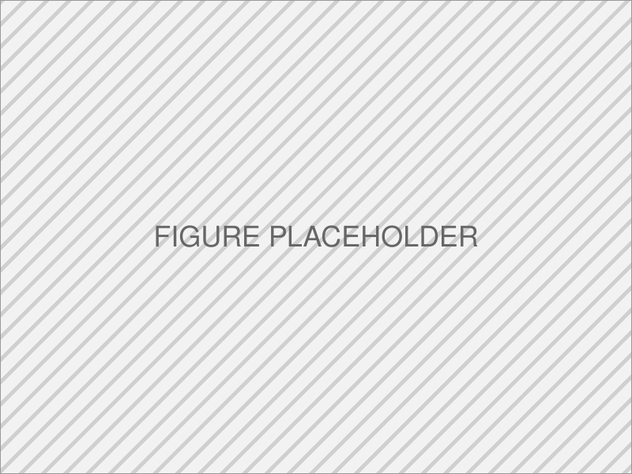

{width="6.5in"}

**Figure S1. ALAD cohort and cell type composition.**
() ALAD cohort of 47 BAL samples from 45 lung transplant recipients: 17 stable controls and 30 with ALAD, of whom 17 declined and 13 recovered.
() Fraction of each sample's cells in each annotated cell type for control (n = 17), declined ALAD (n = 17), and recovered ALAD (n = 13) samples, on a square-root scale.
Boxes show the median and interquartile range, whiskers 1.5× the interquartile range.
q: Kruskal--Wallis test across the three groups, Benjamini--Hochberg corrected across cell types.

{width="6.5in"}

**Figure S2. RISE factor matrices.**
() RISE factor matrices representing component loadings of conditions and genes.
For visualization, genes outside the top 10% by weight in any component are omitted and each component is normalized to its largest absolute loading.

{width="6.5in"}

**Figure S3. Stability of RISE and CP components.**
() RISE gene factor and () CP LR pair factor FMS of each component across leave-one-patient-out jackknife replicates (n = 45).
Each replicate's components matched to the reference's by the one-to-one assignment maximizing total FMS (Hungarian algorithm).
Boxes show the median and interquartile range, whiskers 1.5× the interquartile range.
() Distributions of RISE component 3 and CP component 2 FMS across jackknife replicates.

{width="6.5in"}

**Figure S4. CP component 5 sender and receiver cell identity.**
() Per-cell projection onto the eigen-states most heavily weighted by component 5's sender (eigen-state 17) and receiver (eigen-state 15) factors.
() Component 5 sender and receiver eigen-state loadings.
() Expression of canonical respiratory cell type markers\ [@doi:10.1038/s41586-020-2922-4; @doi:10.1038/s41591-023-02327-2] in component 5's sender/receiver groups and all other cells.
() Difference in the fraction of cells detecting each gene against its Wilcoxon rank-sum q (Benjamini--Hochberg corrected across all genes) between () sender and all other cells, () receiver and all other cells, and () sender and receiver cells.
Labeled are () canonical pan-epithelial markers and () epithelium-specific genes selected from those differentially expressed between the groups.

{width="6.5in"}

**Figure S5. Association of CP components, RISE components, and patient covariates with ALAD outcomes.**
() One-way ANOVA η^2^ of each CP component's condition loadings against each ALAD outcome.
\*: q < 0.05, Benjamini--Hochberg corrected across all outcomes and components.
() Per-cell CP component 4 sender against receiver weight, with R^2^ across all cells.
() CP component 4 condition loadings by () six-month and () one-year death.
Lines connect samples from the same patient.
Boxes show the median and interquartile range, whiskers 1.5× the interquartile range.
One-way ANOVA F and η^2^, with p Benjamini--Hochberg corrected across all outcomes and components.
() As in (), for each RISE component's condition loadings.
() One-way ANOVA η^2^ of each patient covariate against each ALAD outcome, with binary covariates coded 0/1.
\*: p < 0.05, uncorrected.

{width="6.5in"}

**Figure S6. Cell embedding of the outcome-associated CP component.**
PaCMAP embedding of all cells' RISE projections, colored by () annotated cell type, () six-month outcome, CP component 4 () sender and () receiver weight, and () projection onto eigen-state 16.
Color scales saturate at the 99th percentile of absolute values.

{width="6.5in"}

**Figure S7. Stability of the CP component--outcome associations.**
() ANOVA η^2^ of each CP component's condition loadings against six-month outcome across leave-one-patient-out jackknife replicates (n = 45), each replicate's components matched to the reference's by CP factor match score.
Diamonds mark the full-cohort η^2^, filled where p < 0.05.

{width="6.5in"}

**Figure S8. CCC-RISE components across communication scoring methods.**
() Factor match score (condition and LR pair modes) of each CP component of the product score to its matched component under each alternate score (left), and the matched components' mean sender and receiver \|cosine\| (right), an independent check of the matching.
() ANOVA η^2^ of each CP component's condition loadings against six-month outcome under each score, numbered by the matched product-score component.
\*: p < 0.05.
() LR pair and () mean sender and receiver cell-type loadings of each matched component under each score, each divided by its largest absolute loading within the component and score.
LR pairs shown are the union of each score's top 3.

<!-- Legacy Supplemental Captions

<!-- {width="6.5in"}

<!-- **Figure S1.
<!-- CCC-RISE model validation and COVID-19 dataset characterization.** (a) Cell type proportion across the patient categories (B cells, epithelial cells, macrophages, natural killer cells, neutrophils, T cells, plasma cells, myeloid-derived suppressor cell, and plasmacytoid dendritic cells. (b) Total cell count per sample with points labeled by their COVID-19 status. (c) Spearman between cell type proportion and the severity of patient samples (1: healthy, 2: moderate, 3: severe). (h) CCC analysis framework using pseudobulk gene expression based on cell types and the tensor factorization CPD. (d) Factor match score (FMS) when comparing the RISE gene and condition factors of the full scRNA-seq COVID-19 dataset to a bootstrapped dataset at various ranks.
<!-- (e, g) Fraction of the variance explained by (b) RISE and (d) CPD for each number of components. (f) FMS when comparing the CPD condition and sender/receiver eigen-state factors of the 4D communication eigen-state tensor (35-component RISE model) to a bootstrapped tensor at various ranks. (i) The condition, sender cell type, receiver cell type, and LR pair factors for each component in the reduced pseudobulk communication tensor.
<!-- (j-k) Normalized communication score between the most weighted sender macrophages and the most weighted (j) receiver macrophages and (k) NK cells for CCL19-CCR7 in for component 6.

<!-- {width="6.5in"}

<!-- **Figure S2.
<!-- CCC-RISE components associate each pattern to specific LR pairs for the scRNA-seq COVID-19 dataset.** (a, c, e, g, i, k, m, o) The top 10 most positively weighted LR pairs identified by CCC-RISE by a 35-component RISE and 8-component CPD model.
<!-- (b, d, f, h, j, l, n, p) The top 10 most negatively weighted LR pairs identified by CCC-RISE by a 35-component RISE and 8-component CPD model.

<!-- {width="6.5in"}

<!-- **Figure S3.
<!-- CCC-RISE components associate each pattern to specific sender and receiver cells for the scRNA-seq COVID-19 dataset for a 35-component RISE and 8-component CPD model.** (a-p) PaCMAP of the RISE projections, with (a-h) sender cells and receiver cells (i-p) colored by the weightings for the indicated component.

<!-- {width="6.5in"}

<!-- **Figure S4.
<!-- CCC-RISE captures biologically relevant cell-cell communication associated with mortality.** (a-c) Percentage of non-zero interactions for all epithelial cells for each sample in (a) PTN-PTPRZ1, (b) PTN-SDC1, and (c) COL4A5-SDC1.
<!-- (d, g, j) The top 10 most positively weighted LR pairs identified by CCC-RISE for (d) component 3, (g) component 5, and (k) component 8.
<!-- (e-f, h-i) Normalized communication score between the most weighted epithelial cells for (e) component 3 and PTN-PTPRZ1, (f) component 3 and PTN-SDC1, (g) component 5 and OCLN-OCLN, and (e) component 5 and PRSS3-F2RL1.
<!-- (k-l) PaCMAP of the RISE projections, with (k) component 8 sender cells and (l) component 8 receiver cells colored by their loadings. (m) Cell type distributions of most weighted component 8 receiver cells (top 1%).

<!-- {width="6.5in"}

<!-- **Figure S5.
<!-- Validation of the CCC-RISE model and characterization of the ALAD patient cohort.** (a) Cell type proportion (CD4 T cells, CD8 T cells, dendritic cells, epithelial cells, macrophages, monocytes, NK cells, and proliferating cells) across the patient categories. (b) FMS when comparing the RISE gene and condition factors of the full scRNA-seq COVID-19 dataset to a bootstrapped dataset at various ranks.
<!-- (c, e) Fraction of the variance explained by (g) RISE and (i) CPD for each number of components. (d) FMS when comparing the CPD condition and sender/receiver eigen-state factors of the 4D communication eigen-state tensor (15-component RISE model) to a bootstrapped tensor at various ranks. (f) PaCMAP of the RISE projections with cells colored by their cell-type annotations. (g) ALAD prediction accuracy of an unpenalized logistic regression model trained on pairs of components. (h) The condition, sender eigen-state, and receiver eigen-state factors. (i) Correlation between CCC-RISE component 13 and component 17 LR pairs with the most highly weighted LR pairs annotated.

<!-- {width="6.5in"}

<!-- **Figure S6.
<!-- CCC-RISE components associate each pattern to specific LR pairs for the scRNA-seq ALAD dataset.** (a, c, e, g, i, k, m, o, q, s, u, w, y, A, C, E, G, I) The top 10 most positively weighted LR pairs identified by CCC-RISE by a 35-component RISE and 8-component CPD model.
<!-- (b, d, f, h, j, l, n, p, r, t, v, x, z, B, D, F, H, J) The top 10 most negatively weighted LR pairs identified by CCC-RISE by a 15-component RISE and 18-component CPD model.

<!-- {width="6.5in"}

<!-- **Figure S7.
<!-- CCC-RISE components associate each pattern to specific sender and receiver cells for the scRNA-seq ALAD dataset for a 15-component RISE and 18-component CPD model.** (a-J) PaCMAP of the RISE projections, with (a-r) sender cells and (s-J) receiver cells colored by the weightings for the indicated component.

<!-- {width="6.5in"}

<!-- **Figure S8.
<!-- Association of specific CCC-RISE components with clinical metadata and outcomes.** (a) Pearson correlation p-value between condition loadings for components 5, 13, and 7 and clinical variables. (b) T-test p-value between condition loadings for components 5, 13, and 17 stratified by categorical clinical information.
<!-- (c, f) Component 5 condition weights stratified by (c) 6-month CLAD status and (f) 1-year CLAD status.
<!-- (d, g) Component 13 condition weights stratified by (d) 6-month CLAD status and (g) 1-year CLAD status.
<!-- (e, h) Component 17 condition weights stratified by (e) 6-month CLAD status and (h) 1-year CLAD status. (i) Stable prediction accuracy of an unpenalized logistic regression model trained on pairs of components.

<!-- {width="6.5in"}

<!-- **Figure S9.
<!-- A subset of CD70-positive cells is a reproducible feature of ALAD.** (a) The percentage of CD70-positive cells within the airway brush samples dataset, subset by cell type. (b) The percent of T cell CD70 positivity within each sample, subset by clinical context.
-->
